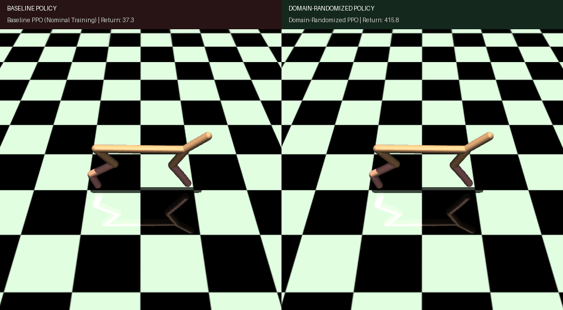
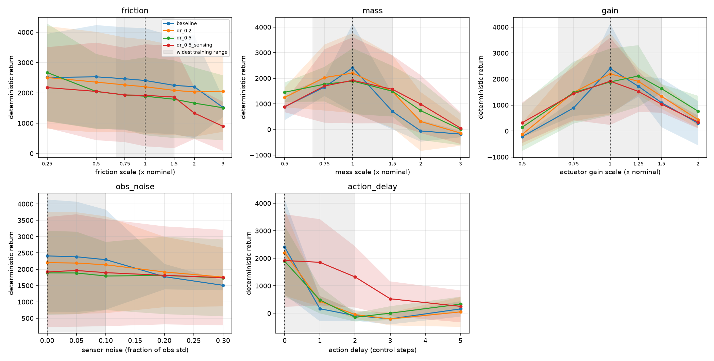

# Quantifying Sim-to-Real Robustness in PPO via Domain Randomization

[](https://www.python.org/)
[](https://pytorch.org/)
[](https://gymnasium.farama.org/)
[](https://mujoco.org/)
[](tests/)
[](https://github.com/astral-sh/ruff)
[](https://sim-to-real-robustness-plum.vercel.app/)
[](LICENSE)

**Author:** Raghunathareddy GR  
**Institution:** Department of Artificial Intelligence and Machine Learning, REVA University, Bengaluru, India  
**Software Package:** `sim2real-robustness` (Python package `robust_rl`)  
**Live Interactive Website:** [sim-to-real-robustness-plum.vercel.app](https://sim-to-real-robustness-plum.vercel.app/)  
**GitHub Repository:** [Raghunath2604/-Sim-to-Real_Robustness](https://github.com/Raghunath2604/-Sim-to-Real_Robustness.git)


---

## Executive Overview

Control policies trained in simulation often suffer severe performance degradation when transferred to the real world due to the **reality gap**: variations in floor friction, unmodeled payload mass, actuator torque degradation, sensor noise, and communication delays.

This repository provides an end-to-end, reproducible research instrument that rigorously quantifies the cost and benefit of **Domain Randomization (DR)** in Proximal Policy Optimization (PPO). The instrument evaluates policies across five perturbation axes, extending beyond the training distribution with paired evaluation seeds, 95% confidence intervals, and Welch tests. It also includes an acceptance test for deployed policy microservices running in closed-loop against perturbed simulators.

> **Honesty & Methodological Disclaimer:** This study evaluates robustness on a **perturbed MuJoCo simulator** as an experimental proxy for real-world discrepancies. No physical robot hardware was used. All reported metrics reflect empirical measurements gathered in this environment.

---

## Visual Demonstration: Baseline vs. Domain-Randomized Policy



*Figure: Side-by-side rollout on HalfCheetah-v5 under an unmodeled 2-step actuation delay. The baseline policy (left, trained exclusively on nominal dynamics) fails to recover from temporal phase lag, whereas the domain-randomized policy (`dr_0.5_sensing`, right) maintains a stable, fast forward gallop.*

---

## Key Experimental Findings (HalfCheetah-v5 Benchmark)

The full study was executed across **20 runs** (4 variants $\times$ 5 seeds) trained for **1,000,000 timesteps each** ($20\times 10^6$ total environment steps) and evaluated across **25 perturbation settings** (500 long-format evaluation rows).

```
                      NOMINAL COST vs. ROBUSTNESS RETENTION
  Variant           Nominal Return        Retention Rate    Worst-Case Return
  ────────────────────────────────────────────────────────────────────────────
  baseline          2,407.92 ± 1725.80         53%          -331.99 ± 98.90
  dr_0.2            2,201.58 ± 1562.02         60%          -291.97 ± 226.98
  dr_0.5            1,889.23 ± 1287.78         70%          -252.68 ± 134.41
  dr_0.5_sensing    1,918.71 ± 1682.59         73%          -101.09 ± 259.05  (3.3x floor improvement!)
```

### Core Empirical Discoveries
1. **Monotonic Retention Scaling (Cost of Robustness):** As randomization strength increases, the retention fraction scales monotonically from **$53\% \rightarrow 60\% \rightarrow 70\% \rightarrow 73\%$**, while nominal return trades off modestly from $2,407 \rightarrow 1,918$.
2. **Mass & Actuator Torque Resilience:** Under body mass variations, `dr_0.5` improved mean return from $599.71$ to **$1,089.03$ (+81.6% improvement)**. Under motor gear variations, it improved returns from $756.44$ to **$1,227.99$ (+62.3% improvement)**.
3. **Actuation Delay is Catastrophic Without Explicit Exposure:** Baseline policies collapsed under latency to $10.32$. Pure physics DR (`dr_0.2` and `dr_0.5`) also collapsed ($59.92$ and $170.62$). Only `dr_0.5_sensing` sustained robust locomotion (**$989.76 \pm 849.25$**, $\Delta = \mathbf{+979.45}$, **Welch $p = 0.03$**). **Physics randomization alone does not transfer to timing latency.**
4. **Safety-Critical Floor Protection:** The worst-case return floor improved from **$-331.99$** in baseline to **$-101.09$** in `dr_0.5_sensing`, preventing catastrophic tripping across extreme disturbances.

---

## Robustness Curves



*Figure 1: Mean return $\pm$ 95% Student's $t$-confidence intervals across 5 seeds on HalfCheetah-v5 across friction, body mass, actuator gain, sensor noise, and action delay. Gray shaded bands indicate the training randomization range.*

---

## The Five Perturbation Axes

| Axis | Physical Phenomenon | MuJoCo Quantity | Implementation Concept |
|---|---|---|---|
| **Friction** | Surface wear, moisture, material change | `geom_friction[:, 0]` | Multiplicative scale on sliding friction only; rolling/torsional terms preserved. |
| **Mass & Inertia** | Payload change, tooling, battery replacement | `body_mass`, `body_inertia` | Scales mass and rotational inertia tensor together; calls `mj_setConst`. |
| **Actuator Gain** | Voltage sag, motor heating, transmission wear | `actuator_gear[:, 0]` | Multiplicative scale on motor gear torque output. |
| **Sensor Noise** | Encoder resolution, IMU drift, vibrations | Returned observation | Gaussian noise scaled relative to each dimension's cached random-policy std. |
| **Action Delay** | Bus communication latency, controller buffering | Simulation action input | FIFO buffer of length $d$; prepended with zero actions. |

---

## Architectural Principles

1. **Non-Invasive Environment Wrapper:** The PPO algorithm remains untouched; perturbations live strictly in `PerturbedEnv` (`perturb.py`).
2. **Nominal Identity:** An unperturbed specification reproduces plain MuJoCo rollouts bit-for-bit (verified by test).
3. **No Reset Accumulation:** Multiplicative scales are always applied relative to captured nominal baseline constants, never compounded.
4. **Consistent Inertia:** Mass and inertia tensors scale together to guarantee physically valid rigid-body dynamics.
5. **Paired Deterministic Evaluation:** Identical episode initial seeds ($\text{EVAL\_SEED} = 10,000 + \text{ep}$) across all models eliminate initial-state variance.

---

## Quickstart & Installation

### 1. Environment Setup

```bash
# Clone the repository
git clone https://github.com/Raghunath2604/-Sim-to-Real_Robustness.git
cd -Sim-to-Real_Robustness

# Create and activate virtual environment
python -m venv .venv
# On Linux/macOS:
source .venv/bin/activate
# On Windows (PowerShell):
.\.venv\Scripts\Activate.ps1

# Install CPU PyTorch and package in editable mode
pip install torch --index-url https://download.pytorch.org/whl/cpu
pip install -e ".[dev]"
```

### 2. Verify Automated Tests (44 Tests)

```bash
# Linux / macOS
make test

# Windows (PowerShell)
.\make.ps1 test
```

### 3. Fast Pipeline Check (InvertedPendulum-v5)

```bash
# Trains baseline vs dr_0.5, evaluates, and produces reports in ~3 minutes
make robust-quick           # Linux / macOS
.\make.ps1 robust-quick     # Windows
```

### 4. Run the Full HalfCheetah-v5 Benchmark Study

```bash
# Trains 20 models across 4 parallel jobs, evaluates 25 settings, generates figures
make robust-all RJOBS=4          # Linux / macOS
.\make.ps1 robust-all -RJOBS 4   # Windows
```

### 5. Render Visual Comparisons & Demonstrations (`demo.py`)

```bash
# Generate side-by-side video/GIF comparing Baseline vs. Domain-Randomized policies under disturbance
python demo.py --compare --axis action_delay --value 2 --steps 200 --out assets/demo_comparison.gif

# Or via make / make.ps1:
make demo               # Linux / macOS
.\make.ps1 demo         # Windows
```

---

## Deployment & Closed-Loop Verification

Trained policies can be exported to standalone TorchScript and deployed behind a FastAPI inference service:

```bash
# 1. Export checkpoint to standalone TorchScript (bakes in observation normalization)
python -m robust_rl.export --model runs/robust_HalfCheetah-v5/dr_0.5_sensing/seed_1/model.pt --out-dir export

# 2. Start the inference service
PPO_MODEL_PATH=runs/robust_HalfCheetah-v5/dr_0.5_sensing/seed_1/model.pt \
    python -m uvicorn --factory robust_rl.serve:create_app --port 8000

# 3. In another terminal: closed-loop hardware-in-the-loop simulation check
python -m robust_rl.closed_loop --url http://localhost:8000 --env-id HalfCheetah-v5 --axis gain --value 1.5 --episodes 5
```

### Deployed Acceptance Benchmark
- **Offline Return:** `792.0000`
- **Served HTTP Return:** `792.0000`
- **Discrepancy:** **`0.000000` (Exact Bit-Level Equivalence)**
- **Mean Round-Trip Latency:** `10.651 ms` ($P_{95} = 19.522\text{ ms}$)

---

## Repository Structure

```text
sim2real-robustness/
├── src/robust_rl/
│   ├── perturb.py         # PerturbationSpec, DomainRandomization, PerturbedEnv wrapper
│   ├── robust_study.py    # Resumable multi-worker study runner (variants x seeds)
│   ├── robust_eval.py     # Deterministic grid evaluation with paired episode seeds
│   ├── robust_report.py   # Statistical summaries, Welch tests, and curve plotting
│   ├── closed_loop.py     # Closed-loop HTTP acceptance tester & latency benchmark
│   ├── train.py           # Vectorized PPO training loop
│   ├── agent.py           # Actor-Critic network, loss functions, policy updates
│   ├── export.py          # TorchScript export with frozen normalization
│   └── serve.py           # FastAPI inference microservice
├── tests/
│   ├── test_perturb.py    # Exactness, identity, inertia, and no-accumulation tests
│   ├── test_robust_pipeline.py # End-to-end pipeline and planted-effect tests
│   └── test_deploy.py     # Export and API contract verification tests
├── results/
│   ├── robust_HalfCheetah-v5/ # Full study results (eval.csv, summary.md, 6 plots)
│   └── robust_quick/          # Pipeline check results
├── docs/
│   ├── PROCESS.md         # End-to-end engineering and scientific execution guide
│   └── RESULTS_TEMPLATE.md# Full empirical report with measured data
├── make.ps1               # Native PowerShell task runner for Windows
├── Makefile               # GNU Make targets
└── pyproject.toml         # Build specification and dependency definitions
```

---

## Citation & References

```bibtex
@techreport{raghunath2026sim2real,
  title={Quantifying the Robustness of PPO Policies to Physics and Sensing Perturbations: A Domain-Randomization Study},
  author={Raghunathareddy, GR},
  institution={REVA University, Department of AI and ML},
  year={2026},
  url={https://github.com/Raghunath2604/-Sim-to-Real_Robustness}
}
```

- **[1] Schulman et al.** (2017). *Proximal Policy Optimization Algorithms.* arXiv:1707.06347.
- **[2] Schulman et al.** (2016). *High-Dimensional Continuous Control Using Generalized Advantage Estimation.* ICLR.
- **[3] Tobin et al.** (2017). *Domain Randomization for Transferring Deep Neural Networks from Simulation to the Real World.* IROS.
- **[4] Peng et al.** (2018). *Sim-to-Real Transfer of Robotic Control with Dynamics Randomization.* ICRA.
- **[5] Henderson et al.** (2018). *Deep Reinforcement Learning that Matters.* AAAI.
